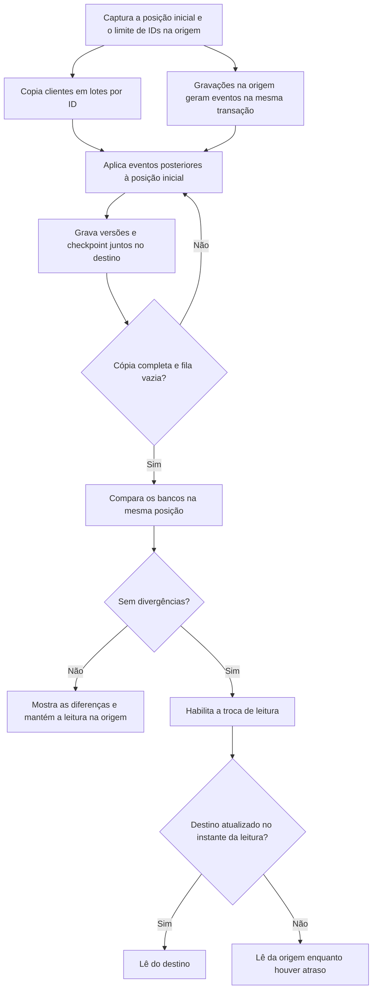

# Ponte · Migração online entre dois PostgreSQL

Ponte é uma demo interativa de como copiar uma base de clientes enquanto a aplicação segue recebendo gravações. O painel acompanha a cópia, inspeciona divergências e controla qual banco atende as leituras. O backend é Java 17 com Spring Boot. As duas bases PostgreSQL são independentes.

## Rodar localmente

Com o Docker e o Docker Compose disponíveis, abra um terminal nesta pasta e execute:

```bash
docker compose up --build -d
```

Abra [http://localhost:8090](http://localhost:8090). A aplicação vem com 32 clientes fictícios. Se a porta já estiver em uso, rode `PONTE_PORT=8091 docker compose up --build -d`. O Compose expõe apenas o painel e a API, na interface de loopback.

Para parar a demo e preservar os dados, use `docker compose stop`. O botão **Reiniciar migração** limpa a cópia e os registros de atividade do destino e mantém os cadastros na origem.

## Roteiro da demo

1. Clique em **Iniciar migração** e **Pausar replicação**. A cópia em lotes continua.
2. Quando o painel mostrar **Replicação pausada**, edite um cliente na origem. A mudança entra no log, o atraso cresce e o botão **Ler do destino** fica indisponível.
3. Clique em **Conferir dados**. A comparação provisória mostra a versão que existe em cada banco.
4. Clique em **Retomar replicação**. Quando a fila zerar, confira de novo e clique em **Ler do destino**. Use **Testar leitura da aplicação** para ver qual banco respondeu.
5. Pause e edite de novo. A leitura volta automaticamente à origem durante o atraso. Ao retomar, ela volta ao destino quando a fila esvaziar. **Voltar para origem** desativa a troca.

## Fluxo de cópia e conferência



### Decisões de engenharia

- **Cópia online.** A cópia usa paginação por chave primária e um limite de IDs capturado ao iniciar. Um cliente criado, alterado ou excluído depois desse ponto tem um evento para ser aplicado na fase seguinte, inclusive se a cópia já tiver passado pelo seu ID.
- **Log transacional.** Triggers registram as mudanças na mesma transação da origem. Um advisory lock por transação serializa as gravações antes da alocação de versões. Isso impede que o worker avance para um evento mais novo enquanto um evento mais antigo ainda está invisível por falta de commit.
- **Reaplicação idempotente.** O destino só aceita uma versão maior que a existente. Uma exclusão mantém um registro interno com a versão da exclusão, impedindo que uma versão anterior recrie o cliente. Os dados do lote e o checkpoint são confirmados na mesma transação.
- **Conferência e troca.** A conferência segura a posição da origem durante a comparação. A API exige cópia completa, replicação ativa, fila vazia e conferência na posição atual, além de revalidar o conteúdo na ativação. Uma gravação nova atrasa o destino e aciona o fallback até o checkpoint alcançar a origem.
- **Retomada.** O progresso, o modo de leitura e a atividade ficam no banco de destino. Um ciclo interrompido pode ser retomado a partir do último lote confirmado.

O escopo é uma tabela pequena, com gravações sempre na origem e troca apenas de leitura. A trava global e a conferência integral simplificam a prova de consistência e limitam o volume adequado ao desenho. Para uma migração de alto volume, eu avaliaria captura do WAL por posição de commit e validação por partições.

## Contrato HTTP

| Método e rota | Resultado |
|---|---|
| `GET /api/migracao` | Estado da cópia, checkpoint, fila, atraso, rota ativa e atividade |
| `POST /api/migracao/iniciar` | Inicia uma cópia e retorna `204` ou `409` se já existir uma migração |
| `POST /api/migracao/pausar` e `/retomar` | Controlam a aplicação de eventos e retornam `204` |
| `POST /api/migracao/conferir` | Devolve as posições comparadas, o total de diferenças e uma amostra de até 20 registros |
| `POST /api/migracao/ativar-destino` | Habilita a leitura no destino com `204` ou explica o bloqueio com `409` |
| `POST /api/migracao/voltar-origem` e `/reiniciar` | Reverte a leitura ou limpa a cópia do destino |
| `GET /api/clientes` | Devolve os clientes e o banco que atendeu a leitura |
| `GET /api/origem/clientes` | Lista os cadastros na origem |
| `POST /api/origem/clientes` e `PUT /api/origem/clientes/{id}` | Recebem `nome` e `email` e retornam o cadastro com sua versão |
| `DELETE /api/origem/clientes/{id}` | Exclui o cadastro e registra a mudança para replicação |

## Verificação de integração

Com a demo rodando em estado inicial e `curl` e `jq` disponíveis:

```bash
./scripts/verificar-demo.sh
```

O roteiro usa registros de teste temporários. Ele valida alteração durante a cópia, exclusão, bloqueio antes da conferência, troca, leitura da versão correta, fallback e recuperação. O script limpa os registros que cria e reinicia a migração de teste ao terminar.
